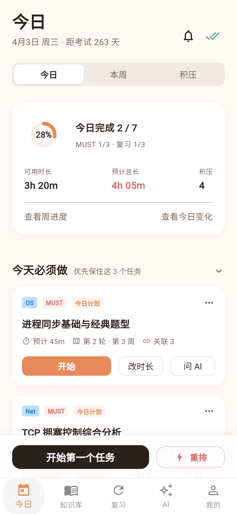
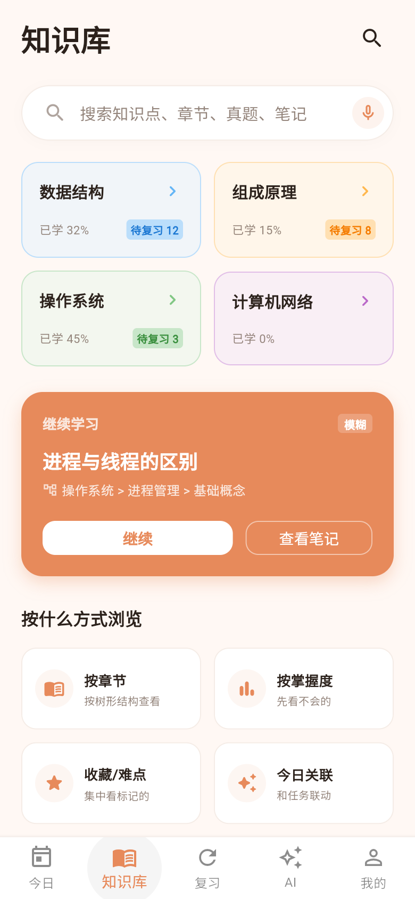
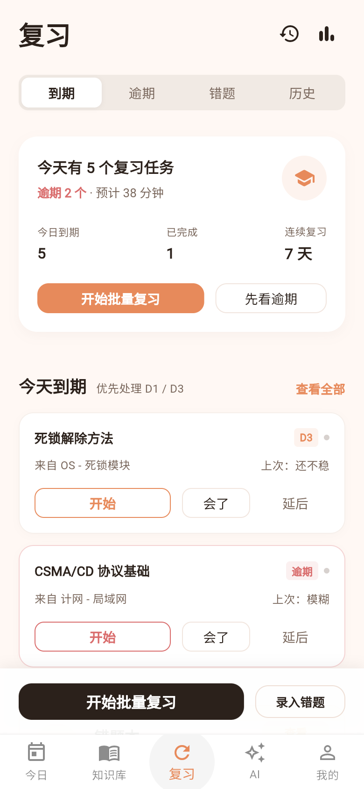
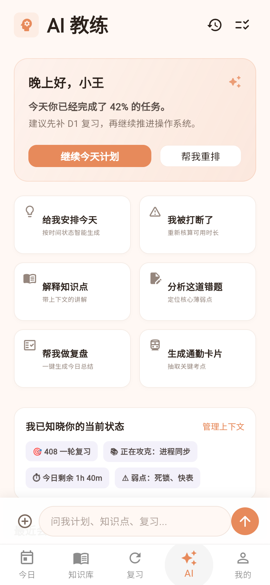
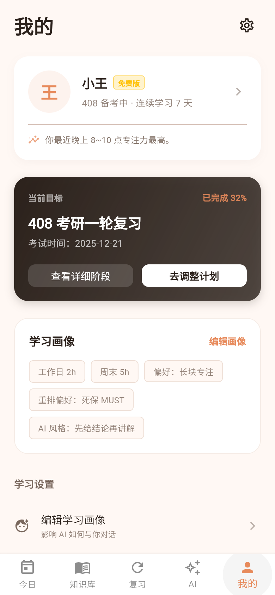

# 408 备考助手（app408）

> 围绕「画像 → 计划 → 今日执行 → 重排 → 复盘 → 复习 → 错题 → AI 辅助」持续运转的移动学习操作系统。

---

## 一、产品定位

- 不是资料堆积型 App（不做内容发现页）
- 不是纯聊天 AI App（不做只有一个输入框的壳）
- 不是单次计划生成器（排一次就结束）

最终交付的**是**：一套可持续运转的学习操作系统。计划会被执行、被中断、被重排、被复盘、被复习、被追踪；AI 只在卡点出现，并且能真正操作这套系统。

产品气质：温暖、克制、有陪伴感、不压迫。用户愿意长期打开的理由是「它每天帮我续上」，而不是「它一次性生成了一份计划」。

---

## 二、最终实现的 8 个核心效果

1. **3 秒看懂今天** —— 打开 App 就知道今天做什么、哪些必须做、时间够不够。
2. **计划真能跑下去** —— 今日计划是真正的首页，任务可执行、可完成、可标记受阻。
3. **断了能接上** —— 突发情况（临时有事 / 状态差 / 任务超时）可一键重排；任务不丢失，只进 Backlog 等待再排。
4. **复习不掉链** —— D0 / D1 / D3 / D7 复习任务与学习任务并列展示，构成闭环而不是附属提醒。
5. **错题自动结构化** —— 拍照上传 → OCR 识别 → 题干 / 答案 / 知识点 / 错因确认 → 进错题本 → 生成复习卡。
6. **AI 是教练不是搜索框** —— 场景化入口 + 上下文感知 + 工具调用（能真的改计划）+ 长任务异步回传，并且**长期记得你**。
7. **长期可信** —— 计划与日程版本化，用户能看到「系统改了什么、为什么改」，而不是被悄悄改掉。
8. **付费买的是持续性** —— 会员卖的是更高频重排、OCR、周报、优先 AI 队列，而不是「生成一次计划」。

---

## 三、主状态机与跳转链路

`未登录 → 已登录 → Onboarding → 全局计划就绪 → 本周激活 → 今日 check-in → 今日执行 → 晚间复盘 → 周复盘`

主跳转链路：

1. 启动页 → 登录页
2. 登录页 → Onboarding
3. Onboarding → 目标创建成功
4. 目标创建成功 → 全局计划生成页
5. 全局计划确认 → 今日计划页
6. 今日计划页 → 任务执行页
7. 任务执行页 → 晚间复盘页 / 重排页 / AI 对话页
8. 晚间复盘页 → 复习任务页 / 错题上传页
9. 周结束 → 周报页

关键二级跳转：今日计划 → Backlog；今日计划 → 知识点详情；任务执行 → 错题上传；错题详情 → AI 讲解；AI 讲解 → 生成通勤卡片；周报 → 一键调整下周计划。

---

## 四、五大首页的最终效果

底部固定 5 个 Tab：**今日 / 知识库 / 复习 / AI / 我的**。

| 首页 | 职责 | 用户能感受到的效果 |
| --- | --- | --- |
| 今日 | 管执行 | 一眼看到今日可用时长、完成进度、MUST / NICE / 复习分组、超载风险 |
| 知识库 | 管查找与继续学习 | 全局搜索、科目四宫格、继续学习卡、易混与薄弱专题 |
| 复习 | 管闭环 | 今天到期 / 已逾期 / 未来 7 天，复习总览卡 + 错题入口 |
| AI | 管卡点求助与智能调度 | 场景快捷卡 + 洞察卡 + 上下文卡 + 最近会话与产物 |
| 我的 | 管长期约束与设置 | 用户信息、当前目标、画像摘要、会员、时间模板、设置 |

**今日首页**要做到「3 秒决策」：顶部显示日期与今日可用时长、已完成进度、复习任务数、积压数；中部依次是今日总进度卡（环形进度）、MUST 分组（`今天必须做`）、NICE 分组（`有余力再做`，默认折叠）、今日复习分组（按 D0/D1/D3/D7 分层）；超载时出现风险提示条「今日任务超载 X 分钟，建议立即重排」+ `去重排`；底部固定 `开始第一个任务` / `突发重排` / 晚间复盘入口。当天首次打开还会弹今日简报卡。

---

## 五、关键页面的最终效果

### 登录与初始化

- **启动页**：3 秒内完成品牌确认与路由判断——已登录且计划已生成直接进今日页，未登录进登录页。
- **登录 / 注册合流页**：只收一个主身份字段（手机号或邮箱），系统自动判断是登录还是注册，新老用户都不必先理解两种入口的差别。
- **验证码页 / 密码登录页**：同一视觉骨架下的两条轻分支，可互相切换；含倒计时重发、`改用密码登录`、字段级错误提示，顶部 banner 仅用于全局错误。
- **登录成功过渡页**：`登录成功` → `接下来用 1~2 分钟，帮你生成更适合你的备考方案` → `开始初始化`。
- **Onboarding**：顶部轻导航 + 右上 Skip + 中部卡片化选择 + 底部固定主 CTA，收集考试时间、当前基础、每日可用时长、学习偏好、拖延 / 风险特征；支持中途退出后恢复进度。

### 计划层

- **全局计划页 / 周视图页**：展示考试日期、当前轮次、已进行天数；周卡片列出每周科目占比、核心任务、预留 buffer；底部是**计划版本入口**（当前版本 / 历史版本 / 对比差异）。
- **今日计划页**：如上文「五大首页」所述，是产品真正的首页。
- **任务执行页**：进入即开始专注，携带 task / goal / subject / knowledge node / 来源类型；状态包含未开始、进行中、中断、完成待确认、完成并已生成复习任务；完成学习任务后系统自动生成 review task。
- **突发重排页**：三屏流程——① 收集突发信息（剩余可用时间、原因、策略偏好、几个开关）② 系统给出方案 A/B/C（保住 MUST / 平滑顺延 / 降低今日压力）③ 确认应用。必须显示旧版本号、新版本号、本次重排时间与触发原因。
- **Backlog 页**：Tab 分为待安排 / 逾期 / 可选 / 已受阻；每张卡显示来源、原计划日期、推荐重排日期；底部 `一键重新安排`、`批量移动到本周`、`清理低优先级`。

### 复盘与复习

- **晚间复盘页**：2 分钟问卷（完成多少 / 实际用时 / 哪个最卡 / 状态 / 是否新增错题 / 时间模板是否要改）+ 自动总结卡（`今天你完成了 4/7`、`OS 比预估多花 35 分钟`、`建议明天减少 1 个 NICE 任务`）；完成后更新掌握度、生成 review task、更新估时模型、触发次日计划微调。
- **复习任务页**：Tab 为今天到期 / 已逾期 / 未来 7 天；复习完成后同样回流到掌握度与后续排程。
- **周报 / 月报页**：本周完成率、各科实际投入 vs 计划投入、最高频错因、最易积压时段、最稳定学习时段、下周建议；移动端只保留 1 个总分卡 + 4 个结论卡 + 1 个建议卡，并支持 `一键应用下周建议`。

### 错题与 OCR

- **错题上传页**：底部 action sheet 选择来源（拍照 / 相册 / 文件）。
- **OCR 处理中页 / 结果确认页**：处理中显示进度与可取消；结果确认页允许逐字段校对题干、答案、知识点、错因。
- **错题列表页 / 错题详情页**：详情页底部提供操作，并带 AI 讲解卡，可从讲解继续生成通勤卡片。

### 会员与设置

- **会员页 / Paywall**：Hero 标题 `让你的计划真正跑下去`；免费版 vs 会员版对比动态重排次数、OCR 识别、通勤卡片、周报 / 月报、深度 AI 错题讲解、优先响应；套餐为月度 / 季度 / 一轮周期包。
- **我的页**：用户信息卡、当前目标卡、学习画像摘要卡、学习设置区（画像编辑 / 时间模板等）、会员入口卡、系统区列表项。
- **画像编辑页**：`保存并应用到当前计划` / `仅保存画像` / `恢复默认推荐`。
- **时间模板页**：工作日 / 周末模板、固定忙碌时段与可学习时段，支持拖拽时间块、复制到其他天、一键应用到本周；与当前计划冲突时提示 `仅更新模板` 或 `同时重排本周`。
- **设置页**：通知设置、隐私与数据、AI 偏好、错题上传设置、外观模式、帮助反馈；通知项预留渠道维度（站内信 / 短信 / 邮件 / Push）。

---

## 六、AI 智能体的最终效果

- **场景入口而非通用聊天**：首页给出 `给我安排今天`、`我被打断了，帮我重排`、`解释一个知识点`、`分析这道错题`、`帮我做晚间复盘`、`生成通勤卡片` 等快捷卡，点进即进入对应场景，并在顶部显示今日完成度与建议（如 `建议先补 D1 复习`）。
- **上下文感知，不失忆**：对话页顶部显示已挂载的上下文（当前任务 / 知识点 / 错题 / 目标 + 画像摘要 + 掌握度摘要），用户能明确感到「这次回答知道我卡在哪」。
- **工具调用真的能操作系统**：助手回复后可渲染工具调用卡片，例如「计划重排就绪：将『OS 死锁练习』与『计网物理层复习』顺延至周六，今日剩余 1 个 MUST 任务」——即 AI 会真正改动计划并回显结果。
- **长任务异步回传**：涉及重新生成全局计划、生成周报、大段错题解析等重任务时，先回一条系统消息，再生成 job 卡片，状态覆盖排队中 / 处理中 / 成功 / 失败 / 可重试，用户不必卡在聊天区等待。
- **能力分级**：强实时问答（解释知识点、分析错题）与异步生成类任务（重排、周报、计划生成）在前端被明确区分，让用户理解系统边界。

---

## 七、模型的长期记忆

### 7.1 三层记忆

- **短期 · 会话消息**：当前这次对话内的上下文，负责「你刚才说了什么」。
- **中期 · 会话摘要**：一次会话结束后压缩成摘要，跨会话保留「我们聊过什么、结论是什么」。
- **长期 · 结构化用户记忆**：从画像、目标、掌握度、错题、复盘中沉淀下来的稳定事实——基础水平、薄弱科目、高频易错知识点、有效学习时段、估时偏差、偏好策略。

### 7.2 记忆怎么形成

- **用户显式提供**：Onboarding、画像编辑、时间模板、目标变更直接成为长期事实。
- **系统自动沉淀**：晚间复盘、任务完成度、错题与复习结果持续累积，修正掌握度与估时模型。
- **会话自动提炼**：对话结束后抽取为会话摘要；被反复确认的重要结论上升为长期记忆条目。

### 7.3 记忆怎么被使用

每次 AI 应答与计划生成前，系统按需装配上下文：当前任务 / 知识点 / 错题 / 目标 + 画像摘要 + 掌握度摘要 + 相关历史摘要。用户在 AI 对话页的「上下文」入口能看到本次挂了哪些记忆——这正是「这次回答不是失忆的」的来源。

### 7.4 用户可控

- **记忆中心**：在「我的」里查看 AI 到底记住了什么，支持逐条编辑与删除。
- **透明可见**：对话中显示本回答参考了哪些记忆。
- **可关闭**：关闭个性化记忆后不再参与后续生成；删除即失效。

### 7.5 与主闭环的关系

记忆不是聊天的附属品，而是反哺整条主链路的：掌握度影响复习排程，估时偏差影响今日计划，薄弱点影响重排策略与通勤卡片内容。也就是说，记忆让「计划 → 执行 → 复盘 → 复习」的每一轮都比上一轮更准。

### 7.6 设计依据

后端方案中 `ai.conversation_sessions`、`ai.conversation_messages`、`ai.memory_summaries` 已定义好持久化结构（支持追加消息与摘要、合并 assessment context），长期记忆的存储骨架已经存在；本仓库需要补齐的是前端呈现与真实读写。

---

## 八、统一体验规范

- **异步友好**：AI 与 OCR 一律不假设「秒回、永不失败」，统一使用 job 状态组件。
- **统一空态**：没有今日计划 / 没有 Backlog / 没有复习任务 / 没有错题 / 没有 AI 历史 / 没有周报数据。
- **统一错误态**：网络失败 / OCR 失败 / AI 生成超时 / 上传失败 / 计划生成失败，每个错误态都给出 `重试`、`稍后再试`、`切换到手动模式`。
- **提交态**：按钮 loading，其余关键入口禁用，不用全屏遮罩。

---

## 九、设计 Token

沿用当前已落地的暖色体系（`lib/shared/theme/app_theme.dart`）：

- 主色 `#E78A5B`，页面背景 `#FFF8F4`，卡片 `#FFFFFF`
- 主文本 `#2B211B`，次文本 `#7A685D`，边框 `#EEDFD6`
- 成功 `#5FAF88`，警告 `#F2B35D`，危险 `#D96C6C`，AI 紫 `#8B7AD1`
- 学科色由配置下发，不在组件里写死（默认 408 四科可各自取色）
- 组件规格：主按钮圆角 14、卡片圆角 16、Bottom Sheet 圆角 24、输入框高 48、底部主 CTA 区高 84

---

## 十、技术框架选型

分三块：前端（本仓库）、后端与 AI 编排（独立仓库 `coach-boot`）、以及「要不要用 LangChain」。

### 10.1 前端（本仓库 · Flutter）

| 能力 | 现状 | 目标选型 |
| --- | --- | --- |
| 框架 | Flutter / Dart ^3.8.1 | 保持 |
| 状态管理 | 裸 `setState` | Riverpod（编译期安全，`AsyncValue` 天然适配异步 job 态） |
| 路由 | 手写 `switch` + `IndexedStack` | go_router（支持深链与登录态重定向） |
| 网络 | 尚无网络层 | dio + retrofit（拦截器统一注入 token、超时与重试） |
| 本地存储 | 无 | flutter_secure_storage（token）+ shared_preferences（轻量偏好） |
| 数据模型 | 手写类 | freezed + json_serializable |
| 测试 | flutter_test | flutter_test + mocktail |

### 10.2 后端与 AI 编排（独立仓库）

已固定的底座：**Java 17、Spring Boot 3.3.5、PostgreSQL、Flyway、Redis、Spring Security、Spring Async**。

| 能力 | 选型 | 说明 |
| --- | --- | --- |
| AI 编排 | **Spring AI** 或 **LangChain4j** | 当前为手写的 `LlmProviderClient` |
| 对话与长期记忆 | Spring AI `ChatMemory` / LangChain4j `ChatMemoryStore` | 对应已有的 `ai.conversation_*`、`ai.memory_summaries` |
| 向量检索 | PostgreSQL + **pgvector** | 已经在用 PG |
| 缓存 | Redis | 已有 |
| 异步任务 | Spring Async 起步，需要重试 / 路由再上 RabbitMQ、Kafka | 对应已有的 `AsyncJobService` |
| 对象存储 | MinIO（自建）或阿里云 OSS / 腾讯云 COS | 已有 `ObjectStorageService` 适配口，当前是 stub |
| OCR | 先接云厂商 OCR API，或自建 PaddleOCR 服务 | 已有 `ocr_parse` job 队列 |
| 可观测 | Spring Boot Actuator + Micrometer | 已有 `ai.call_logs` 与 ops 表 |

---

## 十一、本地运行

```bash
flutter pub get
flutter run            # 或 flutter run -d windows / -d chrome
flutter test
flutter analyze
```

要求 Flutter SDK（Dart ^3.8.1）。详细设计依据见 `前端设计稿/` 目录下的四份文档。

---

## 十三、界面截图


| 今日 | 知识库 |
| --- | --- |
|  |  |

| 复习 | AI |
| --- | --- |
|  |  |

| 我的 |  |
| --- | --- |
|  |  |
